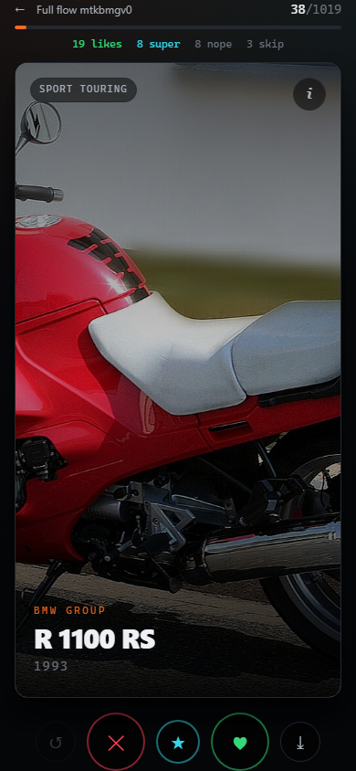
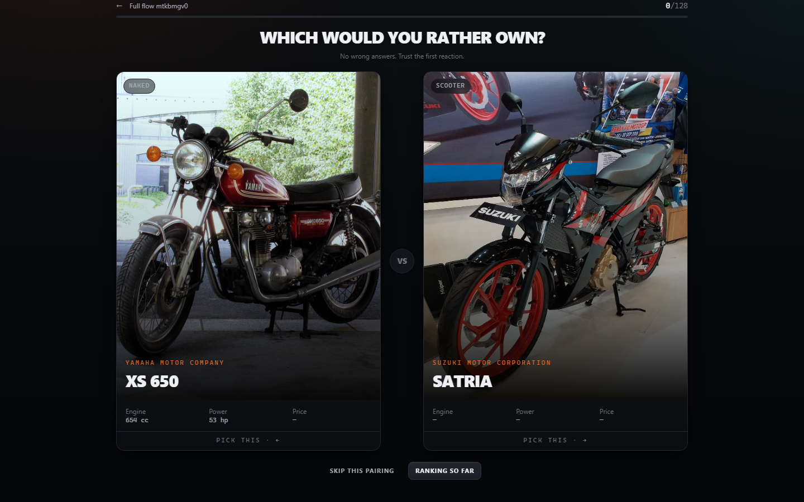
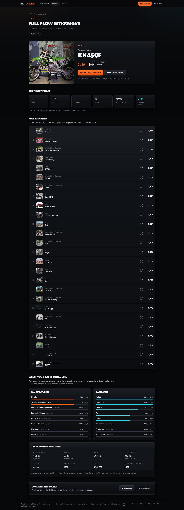
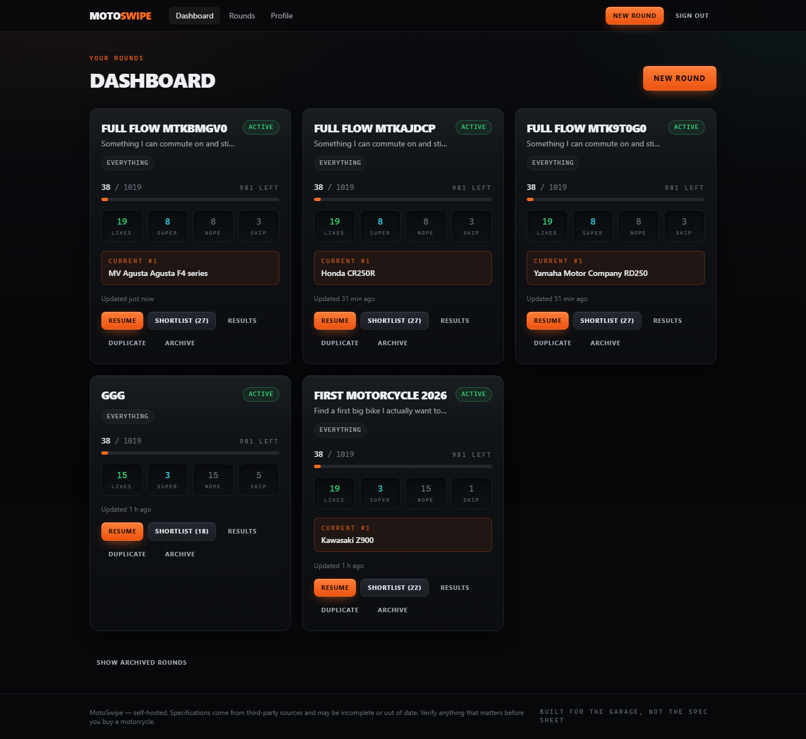
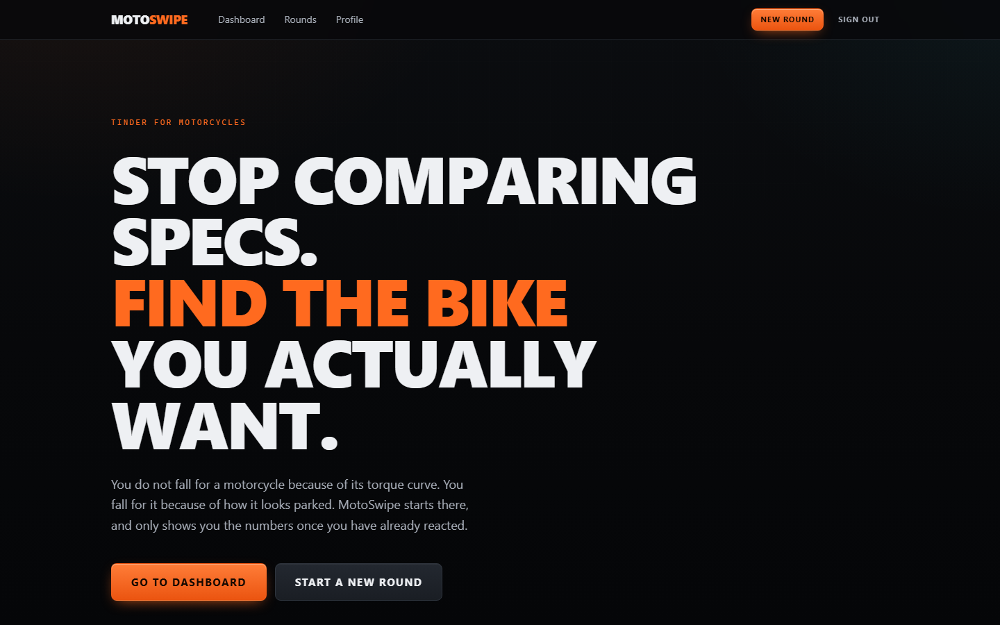
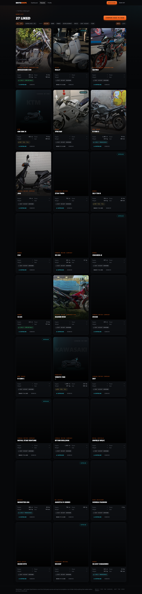
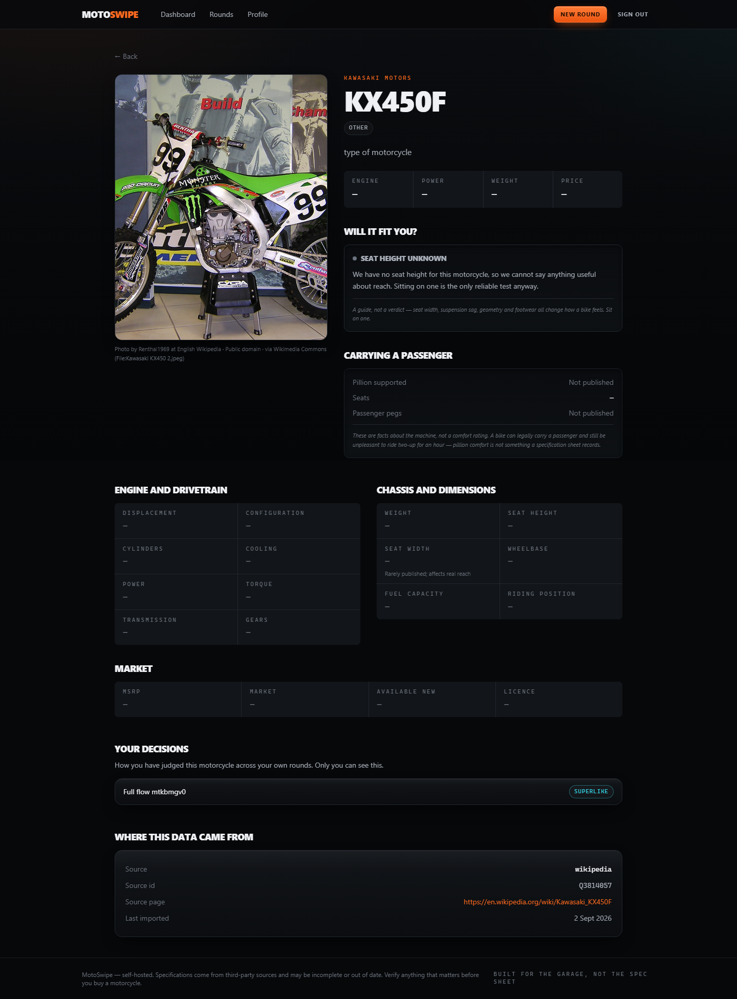
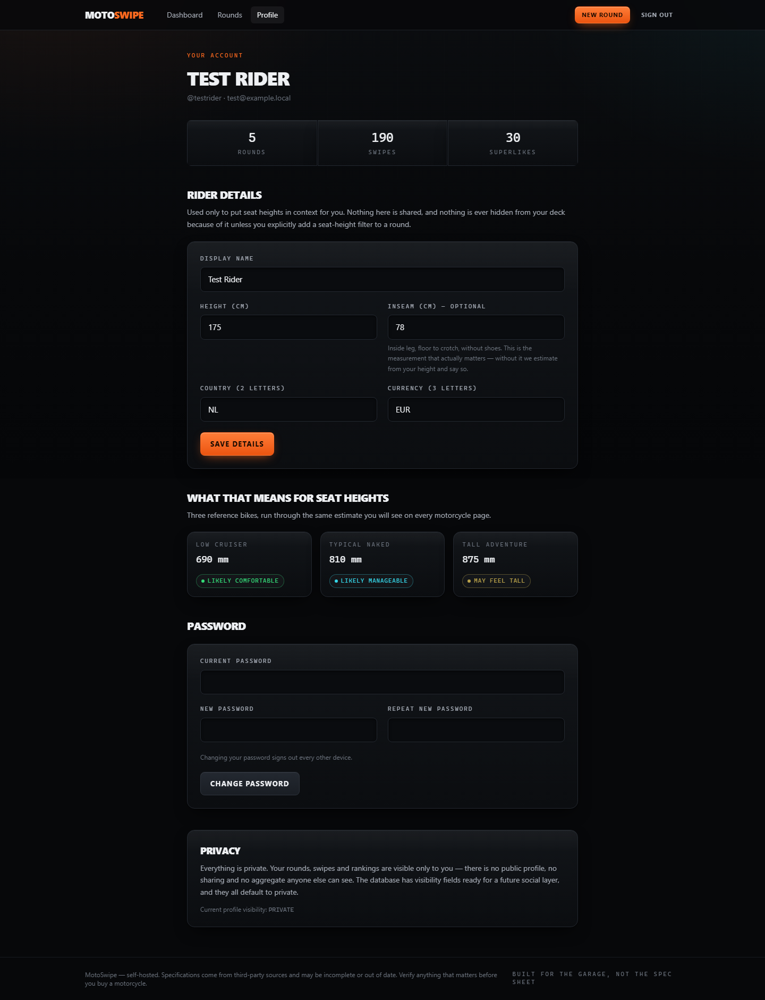

# MotoSwipe

**Tinder for motorcycles.** Create a discovery round, swipe through motorcycles
on looks alone, build a shortlist, then put your favourites head-to-head until
one wins.

Self-hosted. Your rounds live on your server and nowhere else.

---

## Contents

- [What it does](#what-it-does)
- [Screenshots](#screenshots)
- [Quick start](#quick-start)
- [Architecture](#architecture)
- [Database model](#database-model)
- [Development setup](#development-setup)
- [Environment variables](#environment-variables)
- [Database, migrations and seeding](#database-migrations-and-seeding)
- [Testing](#testing)
- [Importers and providers](#importers-and-providers)
- [Image strategy](#image-strategy)
- [Production deployment](#production-deployment)
- [Reverse proxy (Caddy)](#reverse-proxy-caddy)
- [Docker Hub](#docker-hub)
- [NAS deployment](#nas-deployment)
- [Backup and restore](#backup-and-restore)
- [Security](#security)
- [Design notes](#design-notes)
- [Known limitations](#known-limitations)

---

## What it does

You do not choose a motorcycle from a spreadsheet. You choose it because of how
it looks parked, and then you go and justify it with numbers. MotoSwipe is built
around that order of events.

**Discovery rounds.** A round is one question — "first bike 2026", "something
for two-up", "money no object". Each round is completely independent: its own
deck, its own swipes, its own ranking, its own winner. Next year you start a new
one and last year's stays exactly as you left it.

**Swiping.** One motorcycle at a time, full screen, with almost no text. Left
for no, right for yes, up for the ones that genuinely stop you (a superlike),
down to defer. Specifications are one tap away and no closer. Everything saves
as you go — close the tab mid-round and pick it up next week on your phone, in
the same place.

**Comparison.** Two of your liked motorcycles, side by side: _which would you
rather own?_ Answers feed an Elo rating that sorts out what you actually prefer,
which is often not what you thought.

**Results.** A ranked shortlist, a winner, and plainly-counted statistics about
your own taste: which manufacturers you actually like, which categories you keep
rejecting, and what the average bike you liked looks like next to the average
bike you rejected.

**One motorcycle, one card.** Sources name the same machine differently — a
registry files the Yamaha MT-07 as `MTN690` and the Suzuki GSX-8S as `GSX800`,
and writes `Z900 ABS` where an encyclopedia writes `Z900`. Underneath the
catalogue, each source's records are kept exactly as that source stated them,
and the motorcycle you swipe is assembled from all of them: seat height from the
source that publishes seat heights, price from the one that measured actual
vehicles. Every merged value records where it came from. A 1976 Z650 and a 2017
Z650 stay two motorcycles, because sharing a name is not being the same bike.
See [the catalogue notes](src/lib/server/catalog/README.md).

**The catalogue, and a garage.** Not every visit is a decision to make.
`/motorcycles` is a searchable index of everything imported — type "africa
twin", filter by category, manufacturer, year or price, sort by how many are
actually on the road in the Netherlands. Anything you like the look of gets a
heart, and hearted bikes go to your garage: a plain list that expires with
nothing and belongs to no round. When a garage full of motorcycles eventually
poses the question "yes, but which one", one button turns it into a round.

Deliberately separate from swiping. A swipe is an answer given inside one
round — the same bike can honestly be a LIKE in "first bike" and a DISLIKE in
"something for two-up" — while a heart is just a heart.

**Rider fit.** Give it your height and inseam and it puts every seat height in
context — "likely comfortable", "may feel tall" — with its reasoning attached.
It is a hint, never a verdict. See [Design notes](#design-notes).

---

## Screenshots

| Swipe deck (mobile)                                                              | Head-to-head                                                                                     |
| -------------------------------------------------------------------------------- | ------------------------------------------------------------------------------------------------ |
|  |  |

| Results and winner                                                                                      | Dashboard                                                                                       |
| ------------------------------------------------------------------------------------------------------- | ----------------------------------------------------------------------------------------------- |
|  |  |

<details>
<summary>More — landing, shortlist, motorcycle detail, profile</summary>

|                                                                                      |                                                                                            |
| ------------------------------------------------------------------------------------ | ------------------------------------------------------------------------------------------ |
|               |                     |
|  |  |

</details>

> Images in the deck are **generated illustrations, not photographs** — see
> [Image strategy](#image-strategy). To regenerate the whole set against a
> running dev server: `npx tsx scripts/full-flow.ts docs/screenshots`.

---

## Quick start

### With Docker (nothing but Docker required)

```bash
git clone <your-repo> motoswipe && cd motoswipe
cp .env.example .env

# Generate the two secrets. Do not skip this.
sed -i "s|^POSTGRES_PASSWORD=.*|POSTGRES_PASSWORD=$(openssl rand -base64 24)|" .env
sed -i "s|^SESSION_SECRET=.*|SESSION_SECRET=$(openssl rand -base64 48)|" .env

docker compose up -d --build

# Load the demo catalogue and two development accounts.
docker compose exec motoswipe npx tsx prisma/seed.ts

# Then load real data. Wikipedia brings photographs and specifications;
# the Dutch vehicle registry brings prices, recency and thousands more models.
docker compose exec motoswipe npx tsx scripts/import.ts --source wikipedia --allow-network
docker compose exec motoswipe npx tsx scripts/import.ts --source rdw --allow-network

# Finally, find photographs for the registry bikes that arrived without any.
docker compose exec motoswipe npx tsx scripts/fetch-photos.ts
```

Open <http://localhost:3000>. The seed prints the account passwords once.

### Locally, against a Dockerised database

```bash
npm install
cp .env.example .env      # then edit DATABASE_URL to point at localhost

docker compose up -d postgres     # or run your own Postgres
npm run db:migrate
npm run db:seed
npm run import:run -- --source wikipedia --allow-network   # specs + photos, ~4 min
npm run import:run -- --source rdw --allow-network         # prices + recency, ~3 min
npm run db:fetch-photos                                    # photos for the rest
npm run dev
```

Open <http://localhost:5173>.

---

## Architecture

```
src/
├── app.css                     Design tokens and component classes
├── hooks.server.ts             Session resolution, security headers, error handling
│
├── lib/
│   ├── domain/                 Shared with the browser. No server imports.
│   │   ├── enums.ts            Enums + display labels (mirrors the Prisma schema)
│   │   ├── filters.ts          Round filters: Zod schema, normalisation, summaries
│   │   ├── fit.ts              Fit types and the standing disclaimer
│   │   ├── validation.ts       Every shape that crosses the network
│   │   └── view-types.ts       Load-function ↔ component contracts
│   │
│   ├── components/             Presentation only
│   │   ├── SwipeDeck.svelte    The gesture engine
│   │   ├── MotorcycleCard.svelte
│   │   ├── RoundCard.svelte, FitBadge.svelte, SpecGrid.svelte, …
│   │
│   ├── stores/toast.svelte.ts  Rune-backed notifications
│   ├── utils/format.ts         Display formatting (a missing spec renders as —)
│   │
│   └── server/                 Never reaches the browser
│       ├── env.ts              Lazily-validated configuration
│       ├── errors.ts           Domain errors → HTTP status codes
│       ├── guards.ts           requireUser / requireAdmin / requireOwnedRound
│       ├── db/client.ts        Prisma singleton (lazy)
│       ├── auth/               Argon2id hashing, sessions, rate limiting
│       ├── services/           AuthService, RoundService, SwipeService, …
│       ├── ranking/elo.ts      Pure Elo maths and pair selection
│       ├── fit/fit.ts          Rider-fit estimation
│       ├── statistics/         Round and instance aggregation
│       ├── images/placeholder.ts  Generated illustrations
│       └── importers/          Provider abstraction (see its own README)
│
└── routes/                     Thin. Load, guard, delegate, render.
```

**The rule:** business logic lives in `src/lib/server/services`, pure logic in
`ranking/`, `fit/` and `domain/`, and Svelte components render. A component
never queries the database; a service never knows about HTTP.

**Ownership is enforced in one place.** Every round-scoped route goes through
`requireOwnedRound()` in `guards.ts`, which answers **404** — not 403 — for
someone else's round, so guessing a UUID cannot even confirm it exists. There
is an E2E test that tries exactly that.

### Technology choices

| Choice                           | Why                                                                                                                                                                         |
| -------------------------------- | --------------------------------------------------------------------------------------------------------------------------------------------------------------------------- |
| **SvelteKit + adapter-node**     | One `node build/index.js` process. No platform lock-in, no serverless assumptions.                                                                                          |
| **Svelte 5 runes**               | The swipe deck is fine-grained reactive state; runes express it without a store ceremony.                                                                                   |
| **Prisma 7 + driver adapter**    | Prisma 7 talks to Postgres through node-postgres, so there is **no Rust query engine binary** to match to a CPU architecture. The image runs unmodified on amd64 and arm64. |
| **PostgreSQL**                   | Real constraints. The `UNIQUE(roundId, motorcycleId)` on swipes and `onDelete: Restrict` on motorcycles are correctness guarantees, not conventions.                        |
| **Tailwind v4**                  | CSS-first configuration; the design tokens in `app.css` are the single source of truth.                                                                                     |
| **Zod**                          | One schema validates the form, types the service and documents the contract.                                                                                                |
| **Argon2id** (`@node-rs/argon2`) | Memory-hard, OWASP-recommended, with prebuilt bindings for both architectures.                                                                                              |
| **In-memory rate limiting**      | No Redis. A second service to run and back up is a real cost on a NAS, and losing counters on restart is not a meaningful attack.                                           |

---

## Database model

```
User ─┬─ UserProfile        (height, inseam, country, currency, visibility)
      ├─ AuthSession        (token HASH only; no IP address stored)
      └─ DiscoveryRound ─┬─ Swipe                   UNIQUE(roundId, motorcycleId)
                         ├─ ComparisonVote
                         └─ RoundMotorcycleRanking  UNIQUE(roundId, motorcycleId)

Manufacturer ── Motorcycle ─┬─ MotorcycleImage
                            ├─ Swipe                 (Restrict)
                            ├─ ComparisonVote        (Restrict)
                            └─ RoundMotorcycleRanking(Restrict)
```

Decisions worth knowing about:

- **Everything hangs off a round, never off a user.** That is what makes rounds
  independent, and it is why duplicating a round is trivial.
- **Cascades:** deleting a user removes their sessions, profile, rounds, swipes,
  votes and rankings. No orphaned authentication rows, ever.
- **Restricts:** a motorcycle carrying swipe history _cannot_ be deleted. When a
  source drops a model it is retired (`isActive = false`), never removed.
- **`RoundMotorcycleRanking` is a cache.** `RankingService.rebuildRound()`
  recomputes it from the stored votes, and a test asserts the two agree exactly.
- **Visibility fields exist and default to PRIVATE.** `DiscoveryRound.visibility`
  and `UserProfile.profileVisibility` are in the schema so the future social
  layer does not require a core redesign. Nothing reads them for access today —
  `requireRoundReadAccess()` in `guards.ts` is the single seam where they will
  be honoured.
- **Provenance on every motorcycle:** `source`, `externalId`, `sourceUrl`,
  `importedAt`, plus `manuallyEdited` and `protectedFields` so a human
  correction survives the next import.

Indexes cover the queries that matter: `Swipe(roundId)`, `Swipe(roundId,
decision)`, `DiscoveryRound(userId, status)`, `Motorcycle(category, isActive)`,
`Motorcycle(seatHeightMm)`, `MotorcycleImage(motorcycleId, isPrimary)` and more —
see `prisma/schema.prisma`, which is commented throughout.

---

## Development setup

**Requirements:** Node 22+ (24 recommended), Docker (for Postgres), npm 10+.

```bash
npm install
cp .env.example .env
docker compose up -d postgres
npm run db:migrate
npm run db:seed
npm run dev
```

### Scripts

| Command                           | What it does                                      |
| --------------------------------- | ------------------------------------------------- |
| `npm run dev`                     | Development server with HMR                       |
| `npm run build`                   | Production build into `build/`                    |
| `npm run preview`                 | Serve the production build locally                |
| `npm start`                       | `node build/index.js` — what the container runs   |
| `npm test`                        | Unit + integration tests (Vitest)                 |
| `npm run test:unit`               | Pure-logic tests only, no database                |
| `npm run test:e2e`                | Playwright browser journey                        |
| `npm run lint`                    | ESLint + Prettier check                           |
| `npm run format`                  | Prettier write                                    |
| `npm run check`                   | `svelte-check` (TypeScript across `.svelte` too)  |
| `npm run db:migrate`              | Create and apply a migration                      |
| `npm run db:migrate:deploy`       | Apply committed migrations (production path)      |
| `npm run db:seed`                 | Import the demo catalogue and dev accounts        |
| `npm run db:reset`                | Drop, recreate, migrate, seed                     |
| `npm run db:studio`               | Prisma Studio                                     |
| `npm run import:run`              | The importer CLI                                  |
| `npm run db:rebuild`              | Rebuild canonical motorcycles from source records |
| `npm run db:fetch-photos`         | Find Commons photographs for bikes with none      |
| `npm run db:dedupe`               | Merge motorcycles that are the same machine       |
| `npm run db:dedupe-manufacturers` | Merge BMW / BMW Motorrad / BMW Group              |
| `npm run db:backfill-match-keys`  | Recompute cross-source match keys                 |
| `npm run db:repair-model-names`   | Strip a make repeated inside a model name         |

### Development accounts

`npm run db:seed` creates two accounts:

| Account    | Email                 | Role                                 |
| ---------- | --------------------- | ------------------------------------ |
| Admin      | `admin@example.local` | `ADMIN`                              |
| Test rider | `test@example.local`  | `USER` (height 175 cm, inseam 78 cm) |

Passwords come from `SEED_ADMIN_PASSWORD` / `SEED_USER_PASSWORD`. **If those are
unset, the seed generates random passwords and prints them once.** There is no
hardcoded default, so a seeded production database cannot ship with a known
login.

> The **first account registered on a fresh instance automatically becomes
> ADMIN.** Otherwise a self-hosted install has no way to reach `/admin` without
> a manual SQL update.

---

## Environment variables

Copy `.env.example`; it documents every variable inline. The ones that matter:

| Variable                    | Required              | Default       | Notes                                                                                                                                   |
| --------------------------- | --------------------- | ------------- | --------------------------------------------------------------------------------------------------------------------------------------- |
| `DATABASE_URL`              | **yes**               | —             | Postgres connection string                                                                                                              |
| `SESSION_SECRET`            | **yes in production** | dev fallback  | ≥32 chars. Keys the session-token HMAC. Rotating it logs everyone out. `openssl rand -base64 48`                                        |
| `ORIGIN`                    | **yes in production** | —             | Public https URL. SvelteKit checks the `Origin` header of every form POST against it. Get this wrong and **every form silently fails.** |
| `TRUST_PROXY_HOPS`          | behind a proxy        | `0`           | `1` when exactly one reverse proxy is in front. Also set `XFF_DEPTH` to the same value.                                                 |
| `PORT`                      | no                    | `3000`        |                                                                                                                                         |
| `NODE_ENV`                  | no                    | `development` | `production` enables Secure cookies, HSTS and hides stack traces                                                                        |
| `SESSION_TTL_DAYS`          | no                    | `30`          | Sliding: activity past halfway extends it                                                                                               |
| `ALLOW_REGISTRATION`        | no                    | `true`        | Set `false` to close sign-up                                                                                                            |
| `REGISTRATIONS_PER_HOUR`    | no                    | `10`          | Per client address. Everyone behind one home router shares one address, so a family creating accounts needs headroom.                   |
| `POSTGRES_USER/PASSWORD/DB` | for compose           | —             | Used to create the database container                                                                                                   |
| `SEED_*`                    | dev only              | —             | Never set in production                                                                                                                 |

Misconfiguration **fails at startup with an explanatory message**, and settings
that work but will bite (no `ORIGIN`, `http://` origin in production,
`TRUST_PROXY_HOPS=0` behind a proxy) are logged as warnings on boot.

---

## Database, migrations and seeding

Migrations live in `prisma/migrations/` and are committed.

```bash
npm run db:migrate                    # after editing prisma/schema.prisma
npm run db:migrate:deploy             # production: apply, never generate
npm run db:seed
npm run db:reset                      # destroys data
```

**In production, migrations apply themselves.** The container entrypoint runs
`prisma migrate deploy` before starting the server, retrying while Postgres
finishes booting. A `docker compose pull && up -d` upgrade therefore migrates
itself. Set `MOTOSWIPE_SKIP_MIGRATIONS=1` to take manual control.

> Prisma 7 no longer accepts `url` in `datasource`. The connection string lives
> in `prisma.config.ts` for the CLI and is passed to `PrismaClient` through the
> pg adapter at runtime.

---

## Testing

```bash
npm test              # 203 unit + integration tests
npm run test:unit     # pure logic only, no database needed
npm run test:e2e      # Playwright, desktop + mobile
```

Integration tests run against a **real Postgres**, on a separate database. The
setup file refuses to run unless `DATABASE_URL` contains `test`, because the
tests truncate every table.

```bash
createdb motoswipe_test   # or: docker compose exec postgres createdb -U motoswipe motoswipe_test
DATABASE_URL=postgresql://…/motoswipe_test npx prisma migrate deploy
npm test
```

Configuration lives in `.env.test`.

**What is covered:** password hashing and verification, session issue/validate/
revoke/expire/purge, login timing equalisation, rate limiting, round creation
and filtering, **round ownership isolation**, round duplication (config copied,
history not), swipe uniqueness and decision changes, undo, **resume ordering**,
deck exhaustion, shortlist sorting with nulls last, Elo maths and convergence,
pair selection, superlike seeding and its reversal, ranking rebuild-equals-cache,
statistics, and rider fit — including what the fit service must _refuse_ to
claim.

The Playwright journey covers: register → set measurements → create a round →
swipe all four decisions → leave → **resume in the same place** → shortlist →
compare → winner and statistics → duplicate. Plus two security tests: a second
user gets **404** on every route of someone else's round, and an anonymous
visitor is redirected to sign in.

Mocks are avoided on purpose: the interesting behaviour here (unique
constraints, cascades, `Restrict`, transaction rollback, `groupBy`) is behaviour
the database provides, and a mocked Prisma would assert none of it.

---

## Importers and providers

See **[`src/lib/server/importers/README.md`](src/lib/server/importers/README.md)**
for the full contract and a step-by-step guide to adding a source.

Two providers ship:

| Source      | What it is                                                                                         | Network |
| ----------- | -------------------------------------------------------------------------------------------------- | ------- |
| `sample`    | 38 hand-entered demo motorcycles with generated illustrations. Loaded by `db:seed`, works offline. | no      |
| `wikipedia` | **~1,100 real motorcycles with real photographs**, from Wikidata + Wikipedia + Commons.            | yes     |

```bash
npm run import:run -- --list
npm run import:run -- --source wikipedia --allow-network      # ~4 minutes
npm run import:run -- --source wikipedia --limit 20 --dry-run --allow-network
```

Imports are CLI-only — never an HTTP endpoint. A scraper you can trigger with a
web request is a denial-of-service vector pointed at somebody else's server, and
`--allow-network` exists so that reaching the internet is always deliberate.

### What the Wikipedia import gives you

Real numbers from a real run of 1,090 motorcycles:

| Field                   | Populated |
| ----------------------- | --------- |
| Photograph (attributed) | 1,029     |
| Model year              | 918       |
| Displacement            | 717       |
| Weight                  | 578       |
| Power                   | 547       |
| Seat height             | 408       |
| Torque                  | 302       |

No prices — neither source publishes them, so the price filter and the average-
price statistic stay empty on a Wikipedia-only catalogue. Everything else that
is missing is genuinely null and renders as an em dash.

The import is idempotent: run it again and it reports `created 0, updated 1089`.
It never overwrites a human correction, never invents a value the source did not
state, and never deletes a motorcycle carrying swipe history.

### Licensing

Wikidata is CC0. **Wikipedia prose is CC BY-SA**, so the provider imports _facts
only_ — a displacement is not copyrightable, a paragraph is. **Commons
photographs require attribution**, so the licence and photographer are stored on
every image row and shown on the motorcycle page.

Set `WIKIMEDIA_CONTACT` so the API User-Agent identifies your instance. Wikimedia
asks for it, and it is the difference between being a good citizen and being
blocked.

## Image strategy

The seed ships **no photographs**, because there is no licence to redistribute
manufacturer press images and inventing one would be worse than having none.

Instead, `src/lib/server/images/placeholder.ts` generates a deterministic
technical illustration per motorcycle: a side profile assembled from real
motorcycle parts — wheels, engine, frame, tank, seat and tail, forks, exhaust —
proportioned per category and tinted from a hash of the slug. A cruiser looks
like a cruiser; an adventure bike looks like an adventure bike. Every one is
stamped **"ILLUSTRATION — NOT A PHOTO"**.

They are served from `/img/placeholder/[seed].svg`, depend only on the URL, and
are cached `immutable`.

`MotorcycleImage` is designed for the migration you will eventually want:

| Column                   | Purpose                                                 |
| ------------------------ | ------------------------------------------------------- |
| `url`                    | What is served today                                    |
| `localPath`              | Set by a future download job; the resolver prefers it   |
| `sourceUrl`              | Where it came from                                      |
| `attribution`            | Licence or credit. Required before self-hosting a file. |
| `width` / `height`       | Avoids layout shift                                     |
| `isPrimary`, `sortOrder` | Gallery ordering                                        |

To move to self-hosted files or S3/MinIO later, write a job that downloads to
`static/media/`, sets `localPath`, and teach one resolver to prefer it. No
schema change, no re-import: `syncImages` matches on URL, so a downloader and a
re-import do not fight each other.

---

## Production deployment

The published image contains no build toolchain, no dev dependencies, runs as a
non-root user under `tini`, and has a healthcheck that **touches the database** —
a process that is listening but cannot reach Postgres reports unhealthy rather
than staying in a load balancer.

```bash
docker build -t youruser/motoswipe:latest .
docker run --rm youruser/motoswipe:latest node --version   # sanity check
```

**PostgreSQL data lives in a named Docker volume, never inside the app
container.** Application updates cannot touch it.

---

## Reverse proxy (Caddy)

MotoSwipe expects to be served at the **root of its own origin** — a subdomain,
not a subpath. That is the normal reverse-proxy arrangement.

Create a shared network once:

```bash
docker network create edge
```

`Caddyfile`:

```caddy
motoswipe.example.com {
    encode zstd gzip

    # The container name from docker-compose.prod.yml, on the shared `edge`
    # network. No port is published on the host.
    reverse_proxy motoswipe:3000

    header {
        # Caddy terminates TLS, so it is the right place for HSTS.
        Strict-Transport-Security "max-age=31536000; includeSubDomains"
        -Server
    }
}
```

Then, in `.env` on the NAS:

```bash
ORIGIN=https://motoswipe.example.com   # must match exactly, https, no trailing slash
TRUST_PROXY_HOPS=1
```

Both matter:

- **`ORIGIN`** is what SvelteKit compares the `Origin` header against on every
  form POST. If it is wrong, logins and every other form fail silently — the
  single most common self-hosting mistake with SvelteKit.
- **`TRUST_PROXY_HOPS=1`** tells adapter-node that exactly one proxy is in
  front, so rate limiting sees real client addresses instead of Caddy's. Setting
  it when there is _no_ proxy would let clients spoof their address, so it
  defaults to `0`.

Caddy obtains and renews TLS certificates automatically; nothing else is needed.

---

## Docker Hub

```bash
docker login

# Single architecture
docker build -t youruser/motoswipe:latest .
docker push youruser/motoswipe:latest

# Multi-arch (recommended: most NAS boxes are amd64, some are arm64)
docker buildx create --use --name motoswipe-builder   # once
docker buildx build \
  --platform linux/amd64,linux/arm64 \
  -t youruser/motoswipe:latest \
  -t youruser/motoswipe:0.1.0 \
  --push .
```

Tag a real version alongside `latest` so a bad deploy can be rolled back by tag.

---

## NAS deployment

1. Copy `docker-compose.prod.yml` and `.env.example` to the NAS.
2. Create `.env`:

   ```bash
   MOTOSWIPE_IMAGE=youruser/motoswipe:latest
   POSTGRES_USER=motoswipe
   POSTGRES_PASSWORD=$(openssl rand -base64 24)
   POSTGRES_DB=motoswipe
   SESSION_SECRET=$(openssl rand -base64 48)
   ORIGIN=https://motoswipe.example.com
   TRUST_PROXY_HOPS=1
   ALLOW_REGISTRATION=true
   ```

3. Start it:

   ```bash
   docker network create edge          # once, shared with Caddy
   docker compose -f docker-compose.prod.yml up -d
   ```

4. Load a catalogue (otherwise there is nothing to swipe):

   ```bash
   docker compose -f docker-compose.prod.yml exec motoswipe npx tsx prisma/seed.ts
   ```

5. Register. **The first account becomes ADMIN.** Then consider setting
   `ALLOW_REGISTRATION=false`.

### Upgrading

```bash
docker compose -f docker-compose.prod.yml pull
docker compose -f docker-compose.prod.yml up -d
```

Migrations apply on start; the database volume is untouched. Verified: a full
`down` / `up` cycle preserves users, rounds, swipes, votes and the catalogue.

In `docker-compose.prod.yml` the database is **not** on the `edge` network and
publishes no port, so only the app container can reach it.

---

## Backup and restore

The database is the only thing that matters. Everything else is rebuildable.

### Backup

```bash
docker compose -f docker-compose.prod.yml exec -T postgres \
  pg_dump -U motoswipe -d motoswipe --format=custom --compress=9 \
  > motoswipe-$(date +%F).dump
```

Nightly, to a directory the NAS itself backs up:

```bash
0 3 * * * cd /volume1/docker/motoswipe && \
  docker compose -f docker-compose.prod.yml exec -T postgres \
  pg_dump -U motoswipe -d motoswipe --format=custom --compress=9 \
  > /volume1/backups/motoswipe/motoswipe-$(date +\%F).dump 2>>/var/log/motoswipe-backup.log
```

A plain-SQL alternative, easier to inspect:

```bash
docker compose -f docker-compose.prod.yml exec -T postgres \
  pg_dumpall -U motoswipe --clean > motoswipe-full-$(date +%F).sql
```

### Restore

```bash
docker compose -f docker-compose.prod.yml stop motoswipe

docker compose -f docker-compose.prod.yml exec -T postgres \
  pg_restore -U motoswipe -d motoswipe --clean --if-exists \
  < motoswipe-2026-09-02.dump

docker compose -f docker-compose.prod.yml start motoswipe
```

Stop the app first: restoring under a live application is how you get a
half-restored database.

**Test your restore.** A backup you have never restored is a hypothesis. Restore
into a throwaway database and check the row counts:

```bash
docker compose -f docker-compose.prod.yml exec -T postgres \
  psql -U motoswipe -d motoswipe -c \
  "SELECT (SELECT count(*) FROM users) AS users,
          (SELECT count(*) FROM discovery_rounds) AS rounds,
          (SELECT count(*) FROM swipes) AS swipes;"
```

---

## Security

Implemented:

- **Argon2id** password hashing (19 MiB, t=2, p=1 — the OWASP baseline), with
  automatic rehashing on login when the parameters are raised.
- **Server-side sessions.** Only an **HMAC of the token** is stored, so a
  read-only database leak does not hand out live sessions — an attacker would
  also need `SESSION_SECRET` from the environment.
- **HttpOnly cookies**, `SameSite=Lax`, `Secure` in production, sliding expiry.
- **No IP addresses stored.** Not needed by any implemented feature, so not
  collected. Rate limiting uses in-memory buckets.
- **Rate limiting** on login (per address _and_ per account), registration and
  password changes.
- **Login timing equalisation** — an unknown account burns the same CPU as a
  wrong password, so response time does not enumerate your users.
- **Ownership checks on every round route**, answering 404 rather than 403.
  Covered by an E2E test.
- **CSRF** via SvelteKit's origin checking on form POSTs (hence `ORIGIN`).
- **Security headers**: `X-Content-Type-Options`, `X-Frame-Options: DENY`,
  `Referrer-Policy`, `Permissions-Policy`, `Cross-Origin-Opener-Policy`,
  `X-Robots-Tag`, and HSTS in production.
- **Server-side validation of everything** with Zod. Client validation is a
  convenience only.
- **No stack traces in production.** Errors get a short correlation code shown
  to the user and logged in full server-side.
- **Parameterised queries** throughout (Prisma).
- **Admin routes gated in one place** (`/admin/+layout.server.ts`), answering
  404 to non-admins.
- **Password change revokes every other session.**
- **Container**: non-root user, `no-new-privileges`, `tini` as PID 1, no
  published database port in production, database off the edge network.

Deliberately not implemented: email verification and password reset (both need
an SMTP dependency the target deployment does not have), and 2FA.

---

## Design notes

### On rider fit

`FitService` returns `LIKELY_EASY`, `LIKELY_OK`, `MAY_FEEL_TALL` or `UNKNOWN`,
always with its reasoning and always hedged. It will say _"likely comfortable"_.
It will never say _"this bike fits you"_.

That restraint is the point. Seat width where your thighs cross it, suspension
sag under your weight, tank shape, boot soles and hip flexibility all matter as
much as the published number — two bikes with an identical 830 mm seat can feel
a hand's width apart. Without a measured inseam the estimate is derived from
height and **says so**.

Fit **never hides a motorcycle** from your deck. There is an explicit
seat-height filter you can turn on yourself, and that is the only way a bike is
excluded on those grounds.

### On passenger information

Facts only: whether the manufacturer supports a pillion, the seat count, whether
passenger pegs are fitted. A bike can legally carry a passenger and still be
unpleasant two-up for an hour, and no specification sheet records that. Where
the answer is unpublished, the UI says _unpublished_ rather than guessing.

### On missing data

A missing specification renders as an em dash — never `0`, never `N/A`, never an
inferred value. Filters only ever narrow: if a motorcycle has no published
horsepower and you ask for 100 hp or more, it is excluded, because we cannot
claim it qualifies.

### On statistics

Plain counting. A like rate is a like rate. Skips are excluded from the
denominator, because "not now" is not "no". Groups with a small sample are
labelled **provisional** rather than presented as a conclusion. No AI, no
inference, no recommendations — yet.

### On the Elo bonus

Superliked motorcycles start at 1540 rather than 1500. A superlike is already a
strong stated preference and starting it level throws that away; 40 points is
about a 56% expected win rate, and four or five head-to-head losses erase it
completely. The comparison phase is allowed to overrule the swipe phase — that
is the entire reason for running it. There is a test for exactly that.

### On the deck order

The deck is shuffled but **stable**: the order is a pure function of
`(roundId, motorcycleId)`. The same round always yields the same sequence, two
rounds over the same catalogue yield different sequences, and a motorcycle
imported next week slots into a fixed position without disturbing anything
already swiped. That is what makes "close the tab, resume next week" work
without storing a cursor.

### Typography

Deliberately system font stacks. The app must run on a NAS with no outbound
internet, and a webfont round-trip is the one thing that would make the swipe
deck feel slow. To use a condensed display face instead, add it to
`--font-display` in `src/app.css` and self-host the files under `static/`.

---

## Known limitations

- **Specification coverage is uneven.** The Wikipedia import gives real
  photographs for 94% of motorcycles but a seat height for only 37%, which
  directly limits how often the rider-fit estimate can say anything. That is the
  source's coverage, not a bug — and the UI shows a dash rather than a guess.
- **No prices at all** from the Wikipedia source, so the price filter and the
  average-price statistic are empty unless you import a source that has them.
- **The catalogue skews historical.** Wikipedia covers a 1953 AJS as thoroughly
  as a 2026 Ducati. Set a `yearMin` filter on a round if you only want modern
  machines.
- **The `sample` provider is demonstration data** — 38 motorcycles with
  approximate, hand-entered specifications and generated illustrations. It
  exists so the app works offline and so the import path is exercised on a fresh
  install; it is not a source of truth.
- **No email.** No verification, no password reset. A forgotten password needs
  an admin and a database update.
- **Rate limiting is in-memory**, so it resets on restart and is per-process.
  Fine for one container; swap for a shared store before running replicas.
- **The deck is built in the application**, not in SQL. At MVP catalogue sizes
  (thousands) this is comfortably fast; at hundreds of thousands, materialise
  the deck into a table keyed by `roundId`. `deck-order.ts` is the only file
  that would move.
- **Social features are designed but not built.** The schema carries the
  visibility fields; nothing reads them for access yet.
- **Must be served at the root of an origin** — a subdomain, not a subpath.
- **Single instance.** Sessions are in Postgres so multiple replicas would work,
  but rate limiting and the migration-on-start entrypoint assume one.
- **The image is around 860 MB**, of which roughly 215 MB is the Prisma CLI. It
  is there because the entrypoint applies migrations on every start, which is
  what makes `docker compose pull && up -d` a safe upgrade. Pruning Prisma
  Studio out of it was tried and reverted — the Prisma 7 CLI requires it even
  for `migrate deploy`. Disk is the cheaper thing to spend here than an upgrade
  footgun.

---

## Licence

Not yet chosen. Add one before publishing the image.
